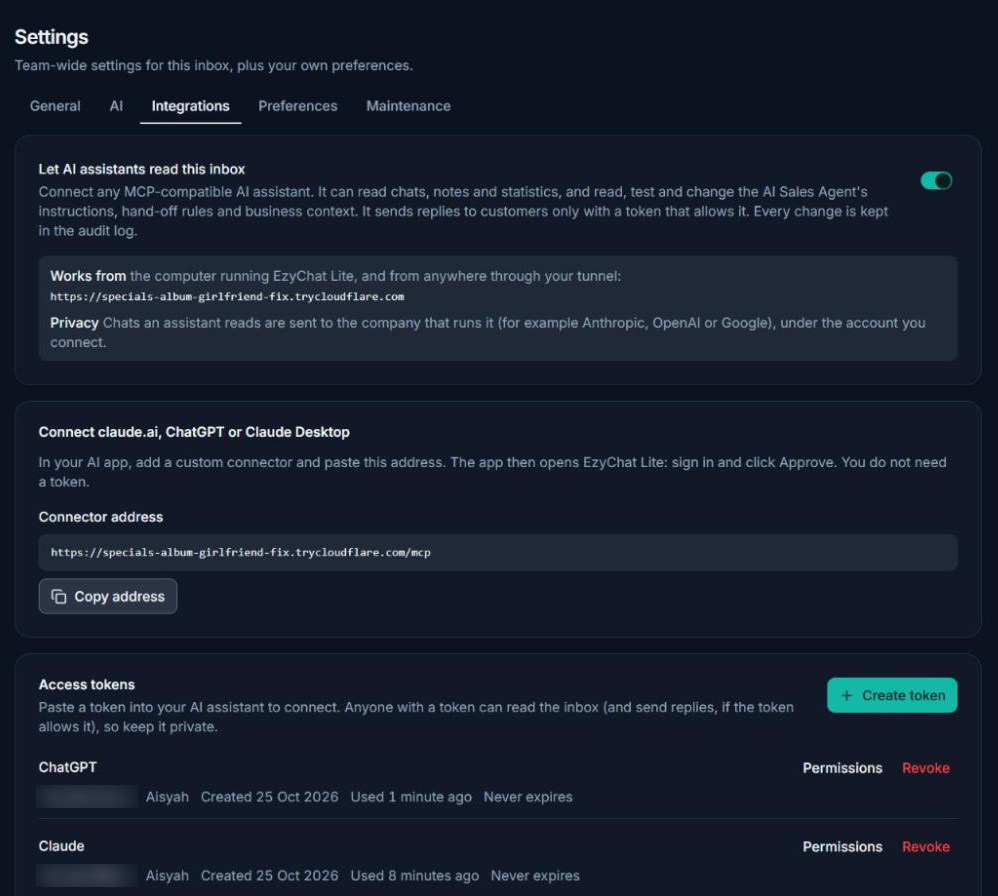
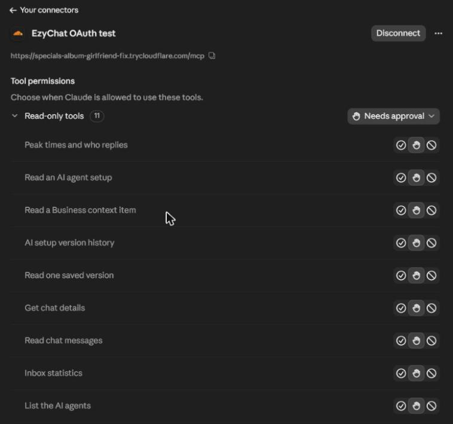
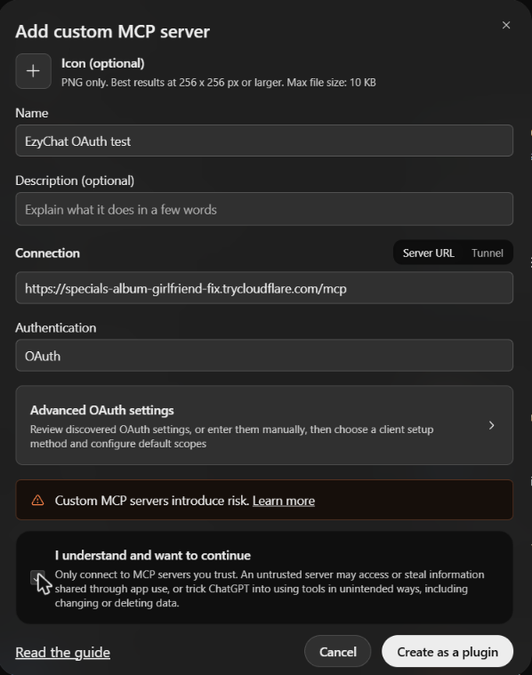
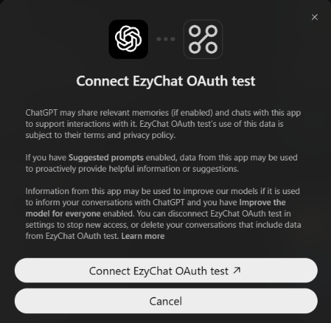
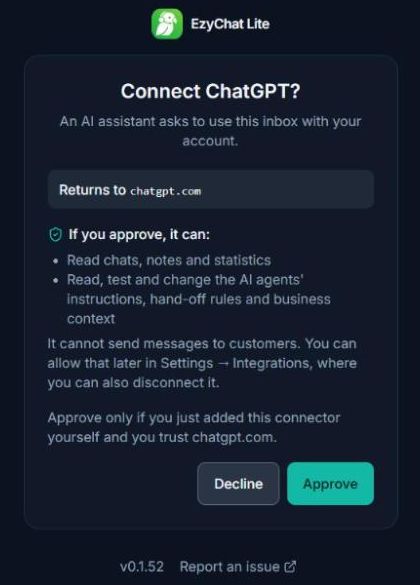
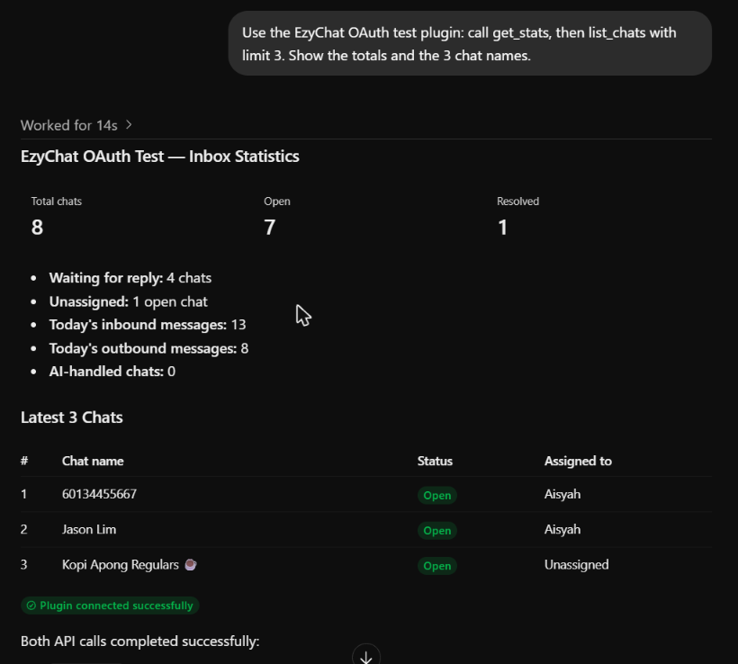

# Connect claude.ai or ChatGPT to EzyChat (no token)

Source material for a user guide. Screenshots come from a Dev Build with demo data, checked with the
real claude.ai and ChatGPT on 2026-10-25 (`feat/mcp-oauth`). The connector address in the pictures is a
temporary test tunnel that no longer works; use the address from your own Settings page.

## Before you start

- You are an **admin** in EzyChat.
- **Phone access** (the tunnel) is on. claude.ai and ChatGPT run in the cloud, so they can only reach
  EzyChat through the tunnel's `https://` address. Claude Desktop or Claude Code on the computer that
  runs EzyChat can use the local address instead.

## 1. Copy the connector address in EzyChat

Admin → **Settings** → **Integrations**. Turn on **Let AI assistants read this inbox**. The card
**Connect claude.ai, ChatGPT or Claude Desktop** shows the address. Click **Copy address**.

Each app you connect later shows here under **Access tokens** (here: ChatGPT and Claude). Use
**Permissions** to let it send messages, or **Revoke** to disconnect it.

## 2a. claude.ai

1. Settings → **Connectors** → **Add** → **Add custom connector**.
2. Enter a name (for example "EzyChat") and paste the address. Click **Continue**.
3. claude.ai finds the sign-in by itself ("Sign in now" and "Register automatically" show
   **Detected**). Click **Add**, then **Connect**.
4. The EzyChat approval page opens (step 3 below).

When it is connected, the connector shows **Disconnect** and the EzyChat tools:

## 2b. ChatGPT

1. Settings → **Plugins** → **Browse directory** → **Add** → **Add custom MCP server**.
2. Enter a name, paste the address in **Connection** (Server URL). Leave **Authentication** on
   **OAuth**. Tick **I understand and want to continue**, then click **Create as a plugin**.

   

3. Click **Connect …**.

   

4. The EzyChat approval page opens (step 3 below).

## 3. Approve in EzyChat

Sign in to EzyChat if it asks. Check **Returns to**: it must be the app you just added
(`claude.ai` or `chatgpt.com`). Click **Approve**. The browser goes back to the app.

The app can read chats, notes and statistics and work on the AI agents' setup. It cannot send messages
to customers until you allow it in Settings → Integrations → **Permissions**.

## 4. Ask a question

In a new chat, ask for example "Which chats are waiting for a reply?". The app calls EzyChat and
answers with your inbox data:

## If something goes wrong

| What you see                                | What to do                                                                   |
| ------------------------------------------- | ---------------------------------------------------------------------------- |
| "AI assistant access is off"                | Turn on **Let AI assistants read this inbox**, then add the connector again. |
| "Only an admin can approve an AI assistant" | Sign in as an admin, or ask an admin to add the connector.                   |
| "This request is not valid or has expired"  | Add the connector again in the app.                                          |
| The app cannot reach the address            | Check that Phone access is on and that you copied the current address.       |
